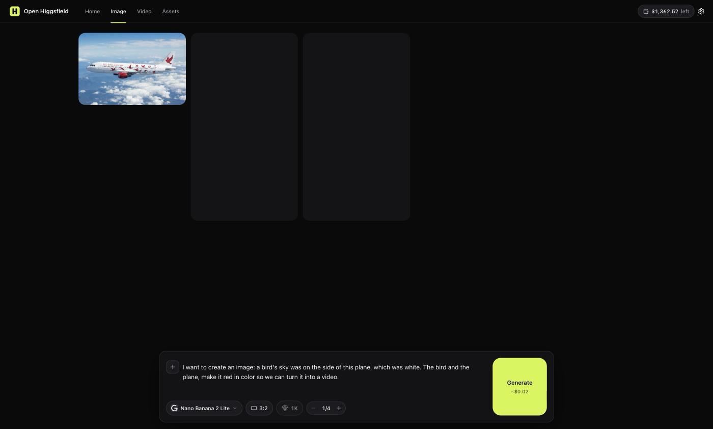

<p align="center">
  
</p>

<h1 align="center">Open Higgsfield</h1>

<p align="center">Open-source, self-hosted AI image and video studio. Runs on your own OpenRouter key.</p>

<p align="center">
  <a href="https://github.com/joymadhu49/open-higgsfield/actions/workflows/ci.yml"></a>
  <a href="LICENSE"></a>
  
</p>

<p align="center"></p>

## What it does

- **Image**: text to image and image to image with Nano Banana Pro, GPT-5.4 Image 2, Krea 2 and more. Reference images, batches of four, 1K to 4K.
- **Video**: text to video and image to video with Seedance 2.5, Kling 3.0, Veo 3.1, Sora 2 Pro, Hailuo 3, Wan 3.0 and more. First and last frame, style references, native audio.
- **Assets**: every generation with its prompt, settings and real cost. Search, download, reuse, animate an image into a video.
- **Your key, your disk**: one OpenRouter key for every provider, billed at provider price. Media and history stay on your machine.

## Quick start

Requires Node 22.13+ and [pnpm](https://pnpm.io). Get a key at [openrouter.ai/keys](https://openrouter.ai/keys).

```bash
git clone https://github.com/joymadhu49/open-higgsfield.git
cd open-higgsfield
pnpm install
pnpm dev
```

Open http://localhost:5173 and paste your key in **Settings**. Or put it in a `.env` file first:

```bash
cp .env.example .env   # set OPENROUTER_API_KEY
```

Production build, one process on port 8787:

```bash
pnpm build && pnpm start
```

### Docker

```bash
cp .env.example .env   # set OPENROUTER_API_KEY
docker compose up -d   # http://localhost:8787, data in ./data
```

## Configuration

| Variable | Default | What it does |
|---|---|---|
| `OPENROUTER_API_KEY` | | Your key. Optional if you enter it in Settings. The env var wins when both exist. |
| `HOST` | `127.0.0.1` | Interface the server binds to. The default is reachable from this machine only; `0.0.0.0` exposes the app on the LAN (pair it with `ALLOWED_HOSTS`). The Docker image sets `0.0.0.0` inside the container. |
| `PORT` | `8787` | Server port. With Docker Compose, also the host port. |
| `DATA_DIR` | `./data` | SQLite database and generated media. Keep it persistent. |
| `ALLOWED_HOSTS` | | Extra hostnames allowed to open the app, comma-separated (LAN IP, Tailscale name). `*` disables the check. |
| `MAX_ACTIVE_JOBS` | `8` | Maximum generations running at once. |
| `APP_URL`, `APP_NAME` | | Sent to OpenRouter for attribution. The host of `APP_URL` is always an allowed hostname. |
| `OPENROUTER_BASE_URL` | `https://openrouter.ai` | Where OpenRouter calls go. Only for proxies and the integration tests. |
| `NODE_ENV` | `development` | `pnpm start` and the Docker image set `production`, which serves `dist/client` from the server. |

There is no login. The server listens on `127.0.0.1` by default and `docker compose` publishes the port on the host's loopback only, so nothing outside the machine can reach it until you say so. Anyone who can reach the port can spend your credits, so widen access only on a private network (LAN, Tailscale) or behind a reverse proxy that adds authentication. Details in [SECURITY.md](SECURITY.md).

### Behind a reverse proxy

The server checks the `Host` header it receives (never `X-Forwarded-*`), so the proxy has to pass the browser's `Host` through and that hostname has to be allowed:

```nginx
server {
    listen 443 ssl;
    server_name studio.example.com;
    # ... your auth (auth_basic, oauth2-proxy, ...) and TLS here ...
    location / {
        proxy_pass http://127.0.0.1:8787;
        proxy_set_header Host $host;            # keep the browser's Host header
        proxy_http_version 1.1;
        proxy_buffering off;                    # /api/events is a server-sent event stream
        proxy_read_timeout 1h;
    }
}
```

```bash
ALLOWED_HOSTS=studio.example.com   # or set APP_URL=https://studio.example.com
```

Caddy and Traefik forward `Host` unchanged by default. Keep the app itself on `127.0.0.1` (the default; with Compose the port is already loopback-only) so the proxy is the only way in. `ALLOWED_HOSTS=*` turns the check off; use it only when the proxy carries authentication and is the sole route to the port.

## Models

11 image models and 25 video models with their real limits (sizes, durations, resolutions, audio). Full list in [docs/MODELS.md](docs/MODELS.md). To add one, edit `src/shared/models.ts`.

New video models OpenRouter lists show up on their own within 10 minutes (the live model list is cached that long) as unverified entries with conservative limits and no price estimate; the real cost is recorded on the result.

Cost estimates are shown before you generate; the actual cost reported by OpenRouter is saved with each result.

## How it works

Vite + React client, Hono server, Node's built-in SQLite. No native dependencies. Image requests go to OpenRouter's chat and image endpoints. Video jobs are submitted to `/api/v1/videos`, polled on the server and downloaded to `DATA_DIR`, so they survive page reloads and restarts. Results stream to the browser over server-sent events.

## Development

```bash
pnpm dev        # server on :8787 and Vite on :5173
pnpm test       # vitest
pnpm typecheck
pnpm lint
```

Docs: [API](docs/API.md), [design](docs/DESIGN.md), [models](docs/MODELS.md), [contributing](CONTRIBUTING.md), [security](SECURITY.md).

## Brand assets

The mark (an H with its crossbar cut open), the lockups and the app-icon tile live in
[docs/brand/](docs/brand/), with sizes, clear space and colour rules in
[docs/brand/BRAND.md](docs/brand/BRAND.md). Use the files as they are: no recolouring, no
effects, no stretching.

## License

MIT. Open Higgsfield is an independent project and is not affiliated with Higgsfield AI. Provider names and logos identify the model providers and belong to their owners.
